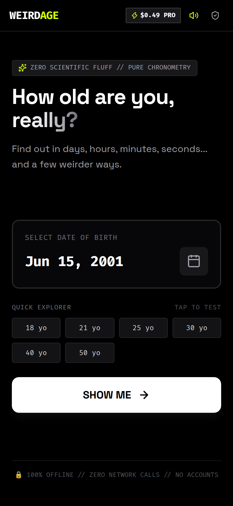
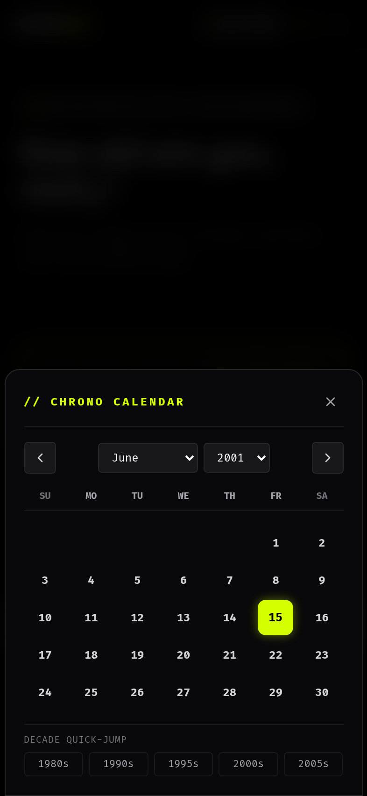
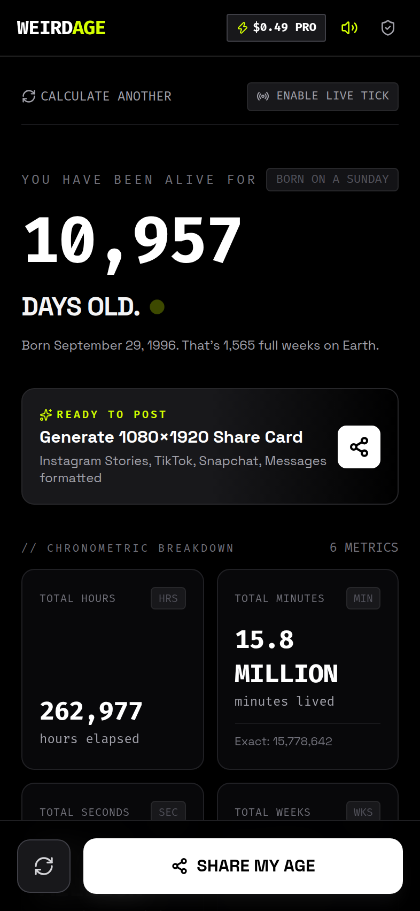
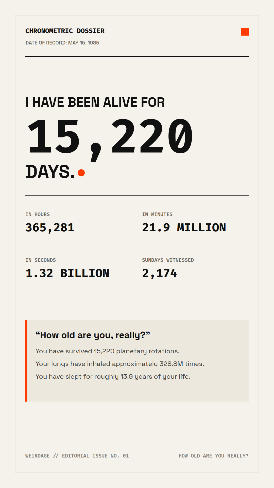
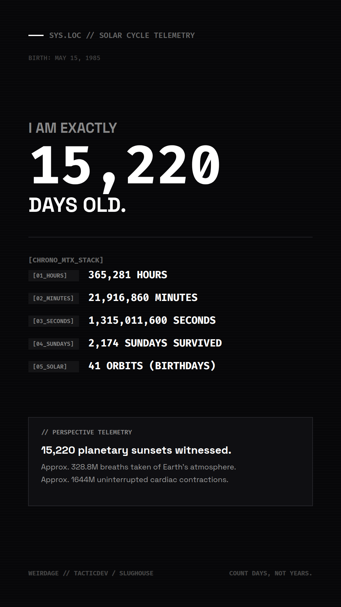
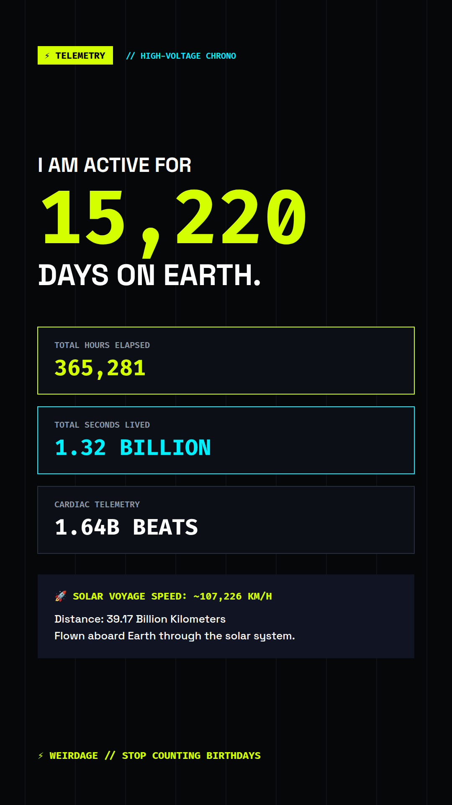
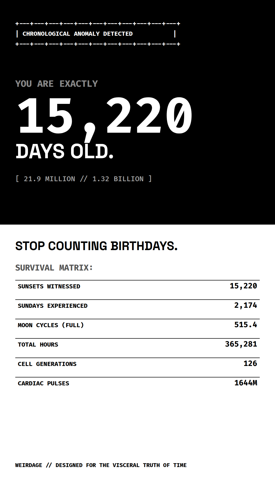

# WEIRDAGE
```text
  _________ _       _   _  ____  _   _  U _____ u ____     
 |  _  _  _ \ |     | | | |/ ___|| | | |\| ___"|/|  _"\    
 "-|_| |_| |-| |    | |_| | |___ | |_| | |  _|"  | |_) |   
   | |     | |___ U|  _  |u|___) |  _  | | |___  |  _ <    
   |_|     |_____| |_| |_| |____/|_| |_| |_____| |_| \_\   
   |||_    <<   >> //   \\  _ _ _ //   \\ <<   >> //   \\_ 
  (__)_)  (__) (__)(_") ("|(___)(_") ("|(__) (__)(__)  (__)
                    TACTICDEV / SLUGHOUSE
```

[](https://tyy130.github.io/weirdage/)
[](https://github.com/tyy130/weirdage/actions)
[](https://github.com/tyy130/weirdage)
[](https://github.com/tyy130/weirdage)
[](LICENSE)

> **"Stop counting birthdays. Count days."**  
> *Translates standard chronological age into visceral, surprising, and aesthetically arresting metrics.*

---

## ⚡ System Overview

People normally describe their age as:
> *"I'm 30 years old."*

**WeirdAge** translates that into visceral, undeniable measurements:
- **10,957 DAYS ALIVE**
- **262,977 HOURS ELAPSED**
- **15.8 MILLION MINUTES**
- **946.7 MILLION SECONDS**
- **1,566 SUNDAYS SURVIVED**
- **30 ORBITS AROUND THE SUN**
- **28.2 BILLION KM TRAVELED ABOARD EARTH'S ORBIT**

It is not a life planner, a horoscope, an AI chatbot, or a health tracker.  
**It is a tiny, frictionless curiosity machine.**

```text
Enter Birthday ───► Upward Digit Reveal ───► Telemetric Perspective ───► Export 1080×1920 Card
```

---

## 📸 Visual Showcase

| Input Deck | Interactive Chrono Calendar | Chronometric Results |
| :---: | :---: | :---: |
|  |  |  |

| Editorial Theme (1080×1920) | Dark / Slughouse MTX Theme (1080×1920) |
| :---: | :---: |
|  |  |

| Electric Theme (1080×1920) | Weird / Brutalist Split (1080×1920) |
| :---: | :---: |
|  |  |

---

## 🛠 Key Capabilities

### 1. Frictionless First-Run Experience
- Zero account setup, zero signups, zero email, zero permissions.
- Large native date input with fast preset jump buttons (`18 yo`, `21 yo`, `25 yo`, `30 yo`, `40 yo`, `50 yo`).
- Immediate upward digit animation with audio sub-pulse.

### 2. Live Chronometer Stream
- Toggle **LIVE TICK** to watch seconds and minutes tick up in real time with millisecond precision.
- Built-in Next Milestone Tracker: forecasts upcoming 1,000 / 5,000 / 10,000 day milestones and exact countdown to your next birthday.

### 3. Slughouse Telemetry & Perspective Engine
- **Cardiac Telemetry:** Continuous uninterrupted heartbeats calculated from human baseline.
- **Atmospheric Intake:** Tidal volume of breaths filtered through lungs.
- **Lunar Cycles:** Synodic moon cycles (29.53-day astronomical orbit) lived through.
- **The Unconscious Void:** Exact years and hours spent in REM & deep sleep states.
- **Solar Voyage:** Kilometers hurtled through space aboard Earth's orbit around the sun (~107,226 km/h).
- **Galactic Drift:** Distance covered as our solar system orbits the Milky Way core (~828,000 km/h).
- **Cellular Turnover:** Complete erythrocyte red blood cell regenerations (120-day cycle).

### 4. 1080×1920 Share Card Studio
- Designed strictly for portrait social sharing: **Instagram Stories**, **TikTok**, **Snapchat**, **iMessage**, and **X**.
- Direct HTML5 2D Canvas rendering engine produces pixel-perfect 1080×1920 PNG files in milliseconds.
- Native `navigator.share` file API support with automatic fallback to direct PNG download.
- 4 Visual Themes:
  - **Editorial:** Warm cream Swiss paper layout, high-kerning typography, international orange accent.
  - **Dark:** Industrial obsidian base, Colter MTX metadata stack, scanline texture.
  - **Electric:** High-voltage Acid Neon Lime (`#D4FF00`) and Cyber Cyan (`#00F0FF`).
  - **Weird:** Surreal monochromatic horizontal split, inverted telemetry, ASCII crosshairs.

### 5. Zero-Knowledge Privacy Architecture
- **100% Client-Side:** All chronometry runs directly on the device processor.
- **Zero Network Calls:** Your birthday is never uploaded to any remote server or cloud API.
- **No Third-Party Trackers:** Zero analytics scripts, zero advertising IDs, zero telemetry beacons.
- **Local Persistence with 1-Tap Erasure:** Birthday is saved locally for convenience and can be wiped instantly.

### 6. Frictionless $0.49 Pro Pass
- One-time impulse purchase. No recurring subscriptions, no paywalls on basic calculations.
- Unlocks Electric & Weird themes, unbranded exports, and Cosmic Telemetry.
- Native configuration files ready for **Apple StoreKit 2** (`storekit/Products.storekit`) and **Google Play Billing** (`googleplay/billing_config.json`).
- Mockable purchase bridge for web simulation and automated testing.

---

## 📐 Mathematical Rigor & Architecture

All calculations reside in [`src/calculations/ageEngine.ts`](src/calculations/ageEngine.ts):
- **Zero Timezone Drift:** Constructs calendar dates in local time components ($year, month, day, 0, 0, 0$) rather than UTC ISO strings, preventing 1-day offsets across GMT boundaries.
- **Leap Year Calculations:** Strictly adheres to Gregorian rules ($year \bmod 4 == 0 \land (year \bmod 100 \neq 0 \lor year \bmod 400 == 0)$). Handles February 29 leap-day birthdays accurately.
- **Exact Sundays Calculation:** Computes exact historical occurrences of calendar Sundays without approximations.

```typescript
// Verified mathematical Sunday counter
const birthDayOfWeek = birthDate.getDay();
const daysUntilFirstSunday = (7 - birthDayOfWeek) % 7;
let sundays = 0;
if (days >= daysUntilFirstSunday) {
  sundays = 1 + Math.floor((days - daysUntilFirstSunday) / 7);
}
```

---

## 🚀 Quickstart & Development

### Requirements
- [Bun](https://bun.sh) (v1.2+) or Node.js (v20+)

### Commands

```bash
# 1. Clone repository
git clone https://github.com/tyy130/weirdage.git
cd weirdage

# 2. Install dependencies (instant via Bun)
bun install

# 3. Start local development server
bun run dev

# 4. Run automated unit test suite
bun run test

# 5. Build production bundle (tsc + vite)
bun run build

# 6. Preview production build locally
bun run preview

# 7. Run automated headless Chrome QA suite
node scripts/qa-runner.js

# 8. Export pristine 1080x1920 social cards
node scripts/export-1080-cards.js
```

---

## 📱 Native Mobile Packaging (Capacitor)

WeirdAge is pre-configured with [Capacitor](https://capacitorjs.com/) for native iOS and Android packaging:

```bash
# Add iOS and Android native platforms
bun add @capacitor/ios @capacitor/android
npx cap add ios
npx cap add android

# Build web assets and sync to native containers
bun run build
npx cap sync

# Open in Xcode or Android Studio
npx cap open ios
npx cap open android
```

### StoreKit 2 Setup
- The file [`storekit/Products.storekit`](storekit/Products.storekit) defines the `$0.49` non-consumable product `com.slughouse.weirdage.pro_unlock_049`. In Xcode, select **Product > Scheme > Edit Scheme > Options > StoreKit Configuration** and point to this file for local transaction testing.

---

## 📂 Project Structure

```text
weirdage/
├── public/                  # App icon PNGs (192, 512, 1024), SVG, and PWA manifest
├── scripts/
│   ├── qa-runner.js         # Automated headless browser QA suite
│   ├── export-1080-cards.js # Raw 1080x1920 PNG card exporter
│   └── render-icons.js      # Multi-resolution icon builder
├── screenshots/             # Live device verification captures
│   └── cards/               # Pristine 1080x1920 social cards
├── storekit/
│   └── Products.storekit    # Native StoreKit 2 testing configuration
├── googleplay/
│   └── billing_config.json  # Google Play In-App Billing spec
├── src/
│   ├── calculations/
│   │   ├── ageEngine.ts     # Pure, deterministic chronometric engine
│   │   ├── ageEngine.test.ts# Vitest edge case test suite
│   │   └── perspective.ts   # Mathematically derived perspective metrics
│   ├── components/
│   │   ├── Header.tsx       # Status deck, UTC clock, sound & privacy triggers
│   │   ├── InputScreen.tsx  # Frictionless date picker & quick explorer
│   │   ├── ResultsScreen.tsx# Hero counter reveal, live ticking, stat cards
│   │   ├── StatCard.tsx     # MTX-style individual metric card
│   │   ├── PerspectiveSection.tsx # "Put That in Perspective" module
│   │   ├── ShareModal.tsx   # 1080x1920 live preview & export engine
│   │   ├── MonetizationModal.tsx # $0.49 Pro Pass unlock bottom sheet
│   │   └── PrivacyModal.tsx # Zero-knowledge client-side privacy modal
│   ├── purchases/
│   │   └── purchaseManager.ts # StoreKit / Google Play billing abstraction
│   ├── storage/
│   │   └── storage.ts       # LocalStorage persistence & data wipe
│   ├── utils/
│   │   ├── audioHaptics.ts  # Web Audio API sub-pulse & haptic feedback
│   │   └── shareCanvas.ts   # Direct HTML5 1080x1920 2D canvas generator
│   ├── types/               # TypeScript interfaces
│   ├── styles/              # Global CSS, Fira Code, scanlines
│   ├── App.tsx              # Root controller
│   └── main.tsx             # Entrypoint & programmatic hooks
├── capacitor.config.ts      # Native iOS/Android packaging config
├── GEMINI.md                # TacticDev ASCII & Colter blueprint context
└── package.json
```

---

## 📄 License & Credits

- **Engineering & Design:** Tyler Hill / [TacticDev](https://github.com/tyy130)
- **Record Label & Aesthetic:** Slughouse Records
- **Standard:** Colter Blueprint (`Fira Code Bold`, MTX UI, Brutalist Industrialism)
- **License:** MIT
